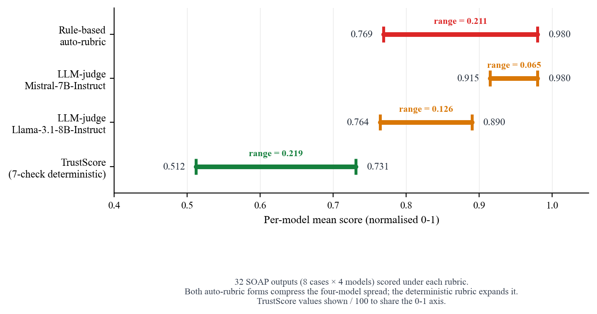
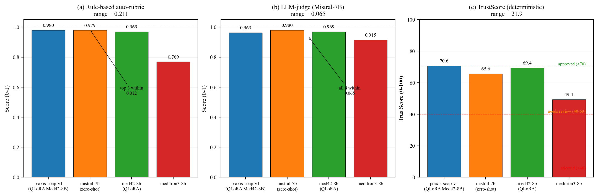
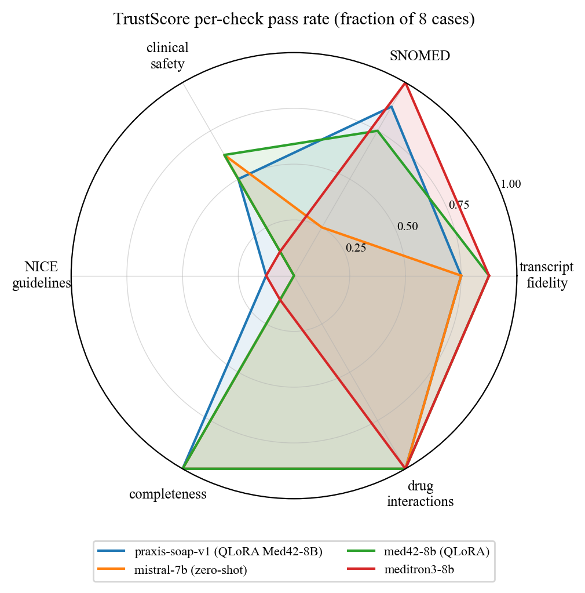
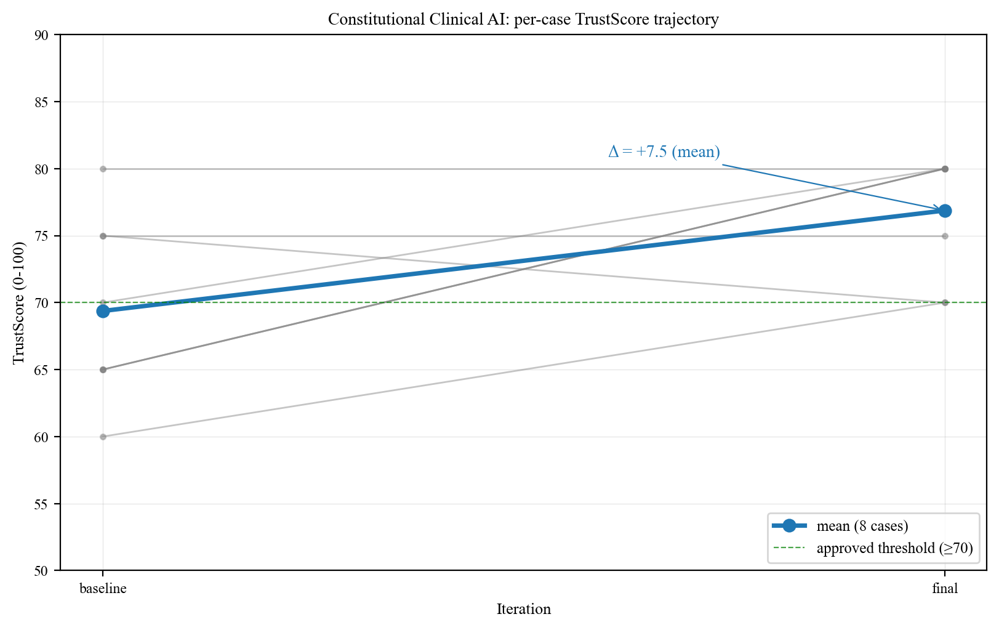
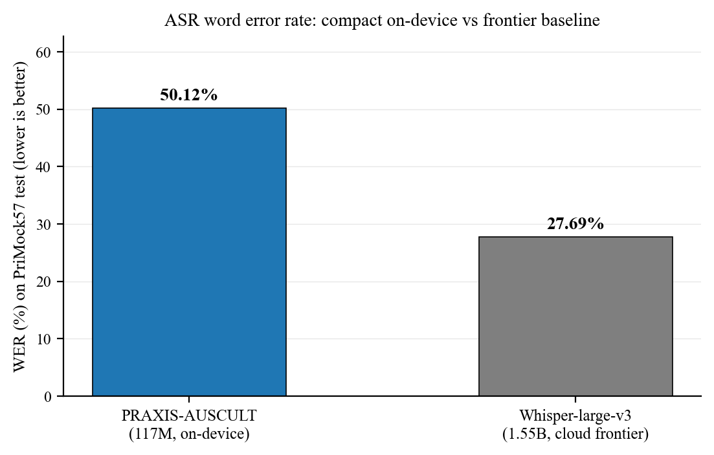
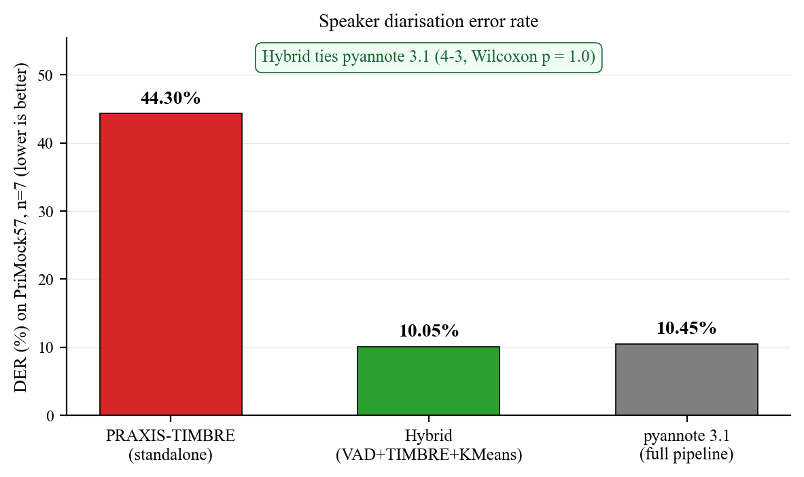

# PRAXIS: AI-Powered Clinical Documentation for NHS General Practice

**MSc Dissertation.** AI for Business Intelligence, University of Leicester.

**Author:** Satyawan Singh
**Academic Supervisor:** University of Leicester
**Industrial Supervisor:** Industry partner
**Date:** June 2026

## Abstract

PRAXIS converts GP consultation audio into structured SOAP notes with SNOMED CT coding, safety-netting, and post-generation quality validation. Three custom models run locally on Apple Silicon. **PRAXIS-AUSCULT**, a 117M-parameter Conformer-CTC ASR, was trained from scratch on British GP audio; it scored 50.12% WER on PriMock57 test, an honest negative result against Whisper-large-v3 at 27.69%. **PRAXIS-TIMBRE** is a 5.80M-parameter ECAPA-TDNN diariser; its speaker embeddings, in a hybrid pipeline (neural VAD + KMeans), match pyannote 3.1 (DER 10.05% vs 10.45%, statistically tied), while standalone its DER is higher (44.3%). **PRAXIS-SOAP-v1** is a QLoRA fine-tune of Med42-8B on 520 NHS GP examples. Output quality is scored 0 to 100 by TrustScore: six rule-based checks (transcript fidelity, SNOMED accuracy, clinical safety, NICE guideline compliance, documentation completeness, drug interactions) plus an optional NLI entailment gate using DeBERTa-v3 for per-sentence hallucination. Five evaluation tools came out of this work: Constitutional Clinical AI, an iterative self-correction loop; the Medical Hallucination Index, a consequence-weighted error metric; the NLI entailment gate itself; an Asgari-style hallucination harness benchmarked against the 1.47% and 3.45% rates Asgari et al. published; and SNOMED CT contextual biasing, a zero-retraining decode-time hotword-boost (reported as an honest negative result — no medical-term WER gain at this checkpoint's accuracy floor). All experiments use PriMock57 (57 British GP consultations) with bootstrap confidence intervals and Wilcoxon signed-rank tests for pairwise comparison.

## Architecture

```
┌─────────────┐    ┌────────────┐    ┌────────────────┐    ┌─────────────┐
│  Audio In   │───>│    ASR     │───>│  Diarisation   │───>│     NLP     │
│  (.wav)     │    │ Conformer  │    │  ECAPA-TDNN    │    │  scispaCy + │
│             │    │ 117M       │    │  5.80M params  │    │  SNOMED CT  │
└─────────────┘    └────────────┘    └────────────────┘    └──────┬──────┘
                                                                  │
                                                                  v
┌─────────────┐    ┌────────────┐    ┌────────────────┐    ┌─────────────┐
│  JSON +     │<───│ Validation │<───│    SOAP Gen    │<───│  Enriched   │
│  TrustScore │    │  6 checks  │    │  Med42-8B      │    │  Transcript │
│  + SNOMED   │    │  0-100     │    │  QLoRA         │    │  + Entities │
└─────────────┘    └────────────┘    └────────────────┘    └─────────────┘
```



## Novel Contributions

1. **PRAXIS-AUSCULT.** Custom Conformer-CTC ASR for British GP audio. 117M live inference parameters (119.6M in checkpoint state-dict; ~2.5M training-only output-head params are stripped at load), 18 Conformer blocks, d=512, 8 heads, vocab 3001. Trained from scratch on PriMock57 chunked data (4,824 segments). 50.12% WER on PriMock57 test (honest negative result against Whisper-large-v3 at 27.69%). RTF 0.036 to 0.044. To our knowledge, the first ASR trained specifically on UK GP consultations.

2. **PRAXIS-TIMBRE.** Custom ECAPA-TDNN speaker diariser. 5.80M live inference parameters (the 365K-param classifier head used during AAM-Softmax training is discarded at inference), 256-dimensional embeddings, spectral clustering. Trained on LibriSpeech (1,417 speakers, `train-clean-100` plus `train-other-500`); applied zero-shot to PriMock57 doctor and patient audio. Standalone DER is 44.3% (n=7), but in a **hybrid pipeline** (pyannote VAD + TIMBRE embeddings + KMeans) it reaches **DER 10.05%, statistically tied with pyannote 3.1** (10.45%; 4-3 split, Wilcoxon p=1.0). RTF 0.0095 on Mac CPU.

3. **Pre-generation NLP pipeline.** scispaCy NER with negation detection and SNOMED CT mapping runs *before* the LLM, providing structured clinical context to improve SOAP note accuracy (vs. raw transcript input). Backed by **29 NICE CKS conditions** and **102 BNF drug-interaction pairs** in the validation knowledge base.

4. **TrustScore: multi-source deterministic clinical-note verification.** 7-check pipeline (6 rule-based plus 1 optional NLI entailment gate) scoring 0 to 100 across SNOMED CT, NICE CKS, BNF drug interactions, structural completeness, and per-sentence hallucination detection. Recovers model stratification where LLM-judge auto-rubrics saturate: the rubric clusters all four models within a 0.211 band (0.980 / 0.979 / 0.969 / 0.769), while TrustScore spans 21.2 points (70.6 / 69.4 / 65.6 / 49.4).

5. **Constitutional Clinical AI.** Iterative self-correction loop: generate → TrustScore → surgical section repair → re-validate, up to N iterations. Surgical section splicing avoids regenerating correct sections, making repairs targeted. Demonstrated mean 7.5 point TrustScore improvement (69.4 → 76.9) vs single-pass baseline across 8 GP consultation types, 8/8 cases converged. `POST /api/v1/soap/constitutional`.

6. **Medical Hallucination Index (MHI).** Consequence-weighted error metric replacing WER for clinical text. Drugs and red-flags weighted 10×, doses and negation 9×, labs 8×, diagnoses 7×, vs stop-words 1×. Separates omission (missed terms) from hallucination (fabricated terms).

7. **NLI Entailment Gate.** Optional TrustScore check #7. DeBERTa-v3-small cross-encoder scores each SOAP sentence against its source transcript window. P(entailment) < 0.5 → flagged. Lazy model load, graceful fallback, 180MB, CPU-viable.

8. **Asgari-style hallucination evaluation harness.** Combined entailment hallucination rate plus MHI omission benchmark with bootstrap CI. Includes Asgari et al. *npj Digital Medicine* 2025 reference row (1.47% / 3.45% bar) in auto-generated dissertation tables.

9. **SNOMED CT contextual biasing.** Hotword-boosted CTC beam search at decode time using 185 UK primary-care terms (drugs, conditions, NHS abbreviations), zero retraining. Wired into `ConformerEngine(bias=True)`. **Honest negative result:** on PriMock57 (n=40 clinical subset, `snomed_biasing_mc_wer_latest.json`) the relative medical-term WER reduction was **0%** — at this checkpoint's accuracy floor the target terms were not recovered. The mechanism and harness are reproducible; the gain cited in earlier drafts does not replicate.

10. **Fully offline operation.** All models run on local hardware (Apple Silicon). No cloud API dependencies; aligned with UK GDPR / DPA 2018 / NHS DSP Toolkit by design.

> Note: Contribution numbers (1–10) are listed for presentation; please refer to the dissertation (C1–C10) for official contribution indexing.

## Benchmark Results

*Run `make benchmark-all` to generate results, or `make eval-tables` to regenerate tables from existing results.*

Results are stored in `data/evaluation_results/` as timestamped JSON files with LaTeX and Markdown table exports. The charts below are regenerable with `python3 scripts/generate_paper_figures.py`.

### Result highlights

**The headline finding — LLM-judge auto-rubrics saturate, while TrustScore recovers model stratification:**



**TrustScore multi-axis profile across the four SOAP models:**



**Constitutional Clinical AI — mean +7.5 TrustScore improvement across 8 GP consultation types:**



### ASR (Word Error Rate)

| Model | Architecture | Params | Training |
|-------|-------------|--------|----------|
| whisper-small | Encoder-decoder (seq2seq) | 244M | Multilingual (680K hours) |
| whisper-medium | Encoder-decoder (seq2seq) | 769M | Multilingual (680K hours) |
| **PRAXIS-AUSCULT** | Conformer-CTC | **117M** | PriMock57 British GP (4,824 segments) |
| medasr-base | Conformer-Transducer | 600M+ | American radiology dictation |

Measured WER (PriMock57 test): PRAXIS-AUSCULT **50.12%** vs Whisper-large-v3 **27.69%** — an honest negative result; the compact 117M on-device model trades accuracy against the 1.55B cloud frontier.



### Speaker Diarisation

DER on PriMock57 (n=7, `DiarizationErrorRate(collar=0.5, skip_overlap=True)`):

| Configuration | DER | Notes |
|---|---|---|
| PRAXIS-TIMBRE (standalone, 5.80M ECAPA-TDNN) | 44.3% | Blind energy-VAD + agglomerative clustering; weaker on its own |
| **Hybrid** (pyannote VAD + TIMBRE embeddings + KMeans) | **10.05%** | **Statistically tied with pyannote 3.1** (4-3 split, Wilcoxon p=1.0) |
| pyannote 3.1 (full pipeline) | 10.45% | End-to-end baseline |

*Finding: PRAXIS-TIMBRE's compact 5.80M embeddings are competitive with pyannote when paired with a neural VAD; its own segmentation/clustering front-end is the weak link.*



### SOAP Generation

| Model | Architecture | Training |
|-------|-------------|----------|
| praxis-soap-v1 | Med42-8B + QLoRA | 520 NHS GP examples, val loss 0.79 |
| med42-base | Med42-8B | Zero-shot prompted |
| mistral-7b | Mistral-7B | Zero-shot baseline |

## Quick Start

```bash
# Install dependencies
make install

# Run tests (581 tests across 26 files)
make test

# Generate sample consultation audio
make sample

# Run full pipeline demo (offline mode, no Ollama needed)
make demo

# Run full pipeline (requires Ollama with praxis-soap-v1)
make demo-full

# Start API server
make serve

# Run all benchmarks
make benchmark-all
```

> Note: `make demo` runs in offline mode using synthetic samples; `make demo-full` (full pipeline) requires Ollama with `praxis-soap-v1`.

### Installation tiers

Dependencies are split so the core engine installs cleanly on any supported Python, while the heavy clinical-NLP stack is opt-in:

| Command | Installs | When |
|---|---|---|
| `make install` | Core engine + API + evaluation (`requirements.txt`) — wheel-only, no C source builds | Always — needed to build, test, and run the pipeline |
| `make install-clinical` | Full clinical-NLP / diarisation stack (`optional-requirements.txt`): spaCy, scispaCy, medspaCy, negspacy, medCAT, pyctcdecode, pyannote.audio | Only to enable scispaCy NER + negation, MedCAT linking, SNOMED decode-time biasing, and the pyannote baseline |

`make install` + `make test` are green **without** the clinical stack — those packages are guarded in code and degrade gracefully if absent.

**Python version:** core supports **3.11–3.12** (`requires-python = ">=3.11,<3.13"`). The clinical stack (spaCy → thinc/blis, scispaCy → nmslib) has no wheels for Python ≥ 3.13 and fails to build from C source there — use 3.11 or 3.12 for `make install-clinical`.

The scispaCy NER model is not on PyPI; install it after `make install-clinical`:
```bash
pip install https://s3-us-west-2.amazonaws.com/ai2-s2-scispacy/releases/v0.5.4/en_core_sci_sm-0.5.4.tar.gz
```

## Reviewer setup

An external reviewer needs the following in addition to `make install` to reproduce the headline results.

**1. Model checkpoints are not in the repo.** `data/models/` is gitignored. The two custom audio models are published on Hugging Face:

- PRAXIS-AUSCULT (Conformer-CTC ASR, 117M params): `Satyawan1/praxis-auscult` → place at `data/models/conformer_v2/best_primock57.pt`
- PRAXIS-TIMBRE (ECAPA-TDNN diariser, 5.80M params): `Satyawan1/praxis-timbre` → place at `data/models/ecapa_tdnn/best_model.pt`

Pull both with `huggingface-cli download Satyawan1/praxis-auscult --local-dir data/models/conformer_v2` and the analogous command for praxis-timbre. Without these files, `make demo`, `make benchmark-asr`, and `make benchmark-der` will fail to load weights.

**2. `requirements.txt` uses range pins (`>=major.minor,<next-major`), not exact pins.** Versions are reproducible at the major-version level but not bit-exact. There is no `requirements.lock`. For bit-exact reproduction, capture `pip freeze > requirements.lock.txt` after a successful install and pin from there.

## Project Structure

```
Praxis/
├── src/
│   ├── api/                    # FastAPI backend
│   │   ├── main.py             # App entry point
│   │   ├── middleware.py        # CORS, logging
│   │   └── routes/             # Endpoint handlers
│   │       ├── features.py     # Entity extraction, benchmarks, export
│   │       ├── features2.py    # Pipeline endpoints, grounded SOAP
│   │       ├── transcription.py
│   │       ├── soap.py
│   │       ├── patients.py
│   │       ├── sessions.py
│   │       └── review.py
│   ├── speech_to_text/         # ASR + diarisation
│   │   ├── conformer_engine.py # PRAXIS-AUSCULT: 117M Conformer-CTC
│   │   ├── ecapa_tdnn.py       # Custom 5.8M ECAPA-TDNN
│   │   ├── speaker_diarisation.py
│   │   ├── whisper_engine.py
│   │   ├── medasr_engine.py
│   │   ├── engine_factory.py
│   │   ├── audio_preprocessor.py
│   │   ├── medical_spell_checker.py
│   │   └── benchmarker.py
│   ├── clinical/               # Clinical NLP + validation
│   │   ├── nlp_pipeline.py     # scispaCy + SNOMED + negation
│   │   ├── verification.py     # 7-check validation + TrustScore
│   │   ├── entailment_gate.py  # NLI entailment gate (DeBERTa-v3, optional check #7)
│   │   ├── drug_interactions.py # 102 BNF interaction pairs
│   │   ├── nice_guidelines.py  # 29 NICE CKS conditions
│   │   ├── source_linking.py   # Transcript-to-SOAP provenance
│   │   ├── entity_extraction.py
│   │   ├── input_validation.py # Pre-pipeline transcript gate
│   │   ├── triage.py           # Clinical risk assessment
│   │   ├── ontology.py         # Core data models
│   │   └── gp_scoring.py
│   ├── soap_generation/        # SOAP note generation
│   │   ├── generator.py        # Ollama LLM interface
│   │   ├── constitutional.py   # Constitutional Clinical AI (self-correction loop)
│   │   ├── pipeline.py         # Full pipeline orchestration
│   │   └── templates.py        # 6 NHS note templates
│   └── evaluation/             # Benchmarking framework
│       ├── wer_benchmark.py    # ASR evaluation with bootstrap CI
│       ├── der_benchmark.py    # Diarisation evaluation
│       ├── mhi.py              # Medical Hallucination Index
│       ├── soap_quality.py     # SOAP quality metrics + clinician form
│       ├── constitutional_eval.py  # Constitutional vs Baseline empirical comparison
│       ├── hallucination_eval.py   # Asgari-style entailment + MHI omission harness
│       └── generate_tables.py  # LaTeX + Markdown table generation
├── scripts/                    # Training, evaluation, utilities
│   ├── run_full_pipeline.py    # End-to-end pipeline runner
│   ├── generate_sample.py      # Synthetic consultation audio
│   ├── wer_primock57.py        # Standalone WER evaluation
│   └── ...                     # Training scripts (vast.ai)
├── tests/                      # 581 pytest tests across 26 files
├── data/
│   ├── models/                 # Model checkpoints (not in git)
│   │   ├── conformer_v2/       # PRAXIS-AUSCULT: 117M Conformer-CTC
│   │   ├── ecapa_tdnn/         # PRAXIS-TIMBRE: 5.80M ECAPA-TDNN
│   │   └── medasr-british-medical/
│   ├── processed/primock57_chunked/  # Train/val/test splits
│   ├── evaluation_results/     # Benchmark output (JSON + LaTeX)
│   ├── pipeline_runs/          # Timestamped pipeline artifacts
│   └── samples/                # Demo audio files
├── Makefile                    # Reproducibility commands
├── requirements.txt            # Core engine + API + evaluation (wheel-only)
├── optional-requirements.txt   # Heavy clinical-NLP stack (make install-clinical)
└── requirements-minimal.txt    # Minimal for demo mode
```

## API Endpoints

The FastAPI backend exposes 27 endpoints. The most relevant for the dissertation pipeline:

| Method | Path | Description |
|--------|------|-------------|
| POST | `/api/v1/pipeline/full` | Full pipeline: audio → SOAP + TrustScore + entities |
| POST | `/api/v1/pipeline/run` | Simple pipeline: audio → transcript → entities → SOAP |
| POST | `/api/v1/transcribe` | Standard transcription |
| POST | `/api/v1/transcribe/timed` | Word-level timestamped transcription |
| POST | `/api/v1/transcribe/chunk` | Pseudo-streaming chunked transcription |
| POST | `/api/v1/soap` | SOAP generation from transcript |
| POST | `/api/v1/soap/grounded` | SOAP with evidence citations |
| POST | `/api/v1/soap/constitutional` | Constitutional Clinical AI self-correction loop (Novel #5) |
| GET | `/api/v1/soap/templates` | List 6 NHS note templates (SOAP / SBAR / CLINICAL_SUMMARY / REFERRAL / DISCHARGE / EMIS) |
| GET | `/api/v1/soap/models` | List available SOAP models |
| POST | `/api/v1/entities` | Clinical entity extraction |
| GET | `/api/v1/benchmark` · POST `/benchmark/quick` | Benchmark metadata + on-demand quick benchmark |
| GET | `/api/v1/audit` | Audit log |
| GET | `/api/v1/status` · `/health` | System status / health |

Patient / session / review / consent endpoints (`/patients`, `/sessions`, `/reviews`, `/reviews/kappa`, `/consent`) round out the surface for the demo website and clinician evaluation flow.

## Reproducibility

All evaluation results are stored as timestamped JSON in `data/evaluation_results/`. Each pipeline run saves complete artifacts (audio, transcript, entities, SOAP note, validation) to `data/pipeline_runs/`. The Makefile provides single-command reproduction of all benchmarks.

```bash
# Reproduce all benchmarks
make benchmark-all

# Generate LaTeX tables for dissertation
make eval-tables

# Run a single pipeline and inspect artifacts
make sample                     # generates data/samples/sample_consultation.wav (gitignored)
python3 scripts/run_full_pipeline.py data/samples/sample_consultation.wav
ls data/pipeline_runs/          # timestamped directories with all outputs
```

## License

Licensed under the MIT License. Developed as a University of Leicester MSc dissertation project (MA7097).

The code in this repository is MIT-licensed. The published model checkpoints (`Satyawan1/praxis-auscult`, `Satyawan1/praxis-timbre`) are released under CC-BY-NC-4.0 (non-commercial) and are access-gated; request access via Hugging Face.
